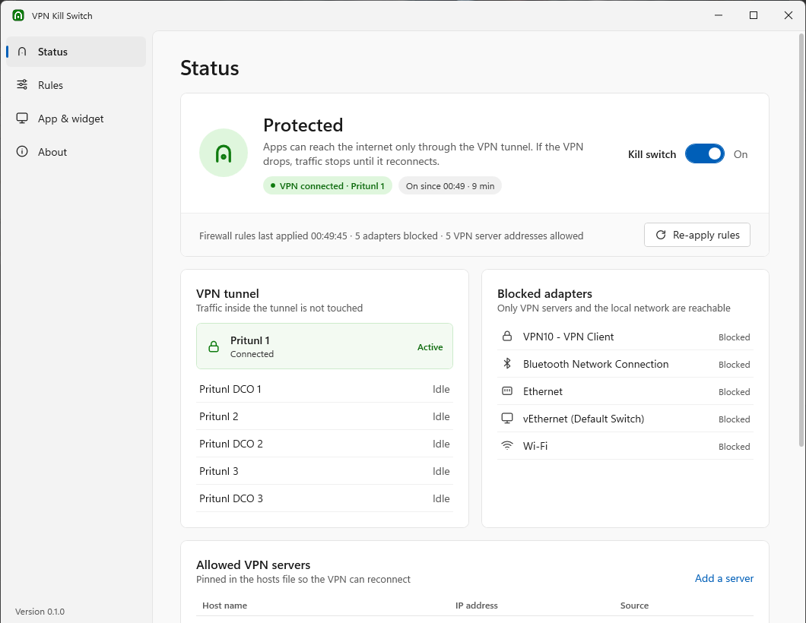
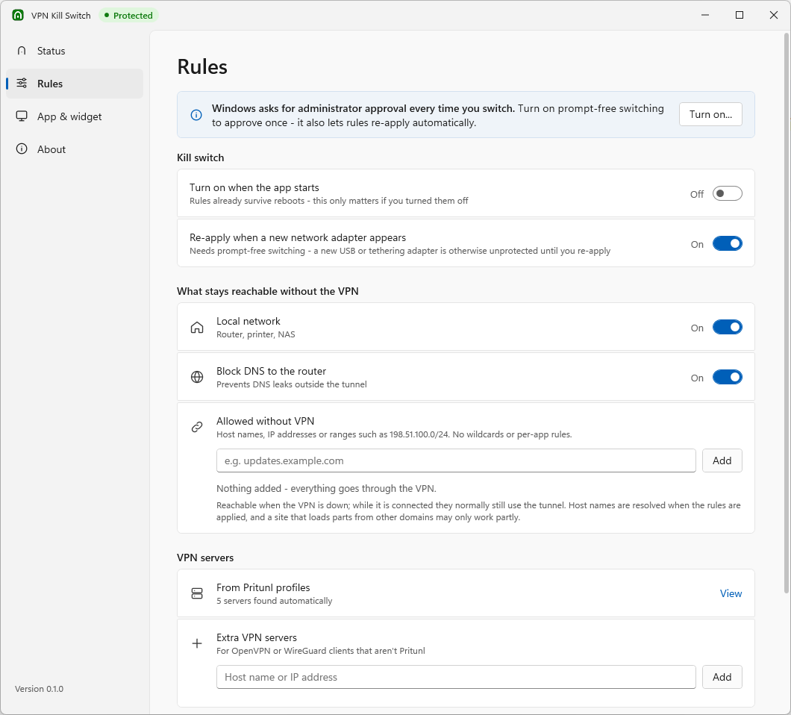
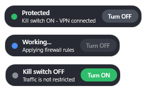

# VPN Kill Switch for Windows

[](https://github.com/DespotMagic/vpn-kill-switch-windows/actions/workflows/ci.yml)
[](https://github.com/DespotMagic/vpn-kill-switch-windows/releases/latest)
[](LICENSE)
[](#install)

A kill switch for VPN clients that don't have a reliable one of their own. While it is on,
programs can reach the internet **only through the VPN tunnel**. If the VPN drops, traffic
stops until it reconnects; nothing falls back to your normal connection.

It was built for [Pritunl Client](https://client.pritunl.com/) and also works with other
OpenVPN and WireGuard clients that create their own network adapter.

It has two parts:

- **`vpn-killswitch.ps1`** – a PowerShell script that does all the work with Windows Firewall
  rules. It can be used on its own.
- **VPN Kill Switch app** – a small tray program that shows the state, switches the kill
  switch on and off, and offers a desktop widget. It only reads the state and runs the script.

> [!WARNING]
> This tool is only as strong as Windows Firewall on your PC. Read
> [When it does not protect you](#when-it-does-not-protect-you) before you rely on it, and
> [test it yourself](#check-that-it-works-on-your-pc) after turning it on.

## Screenshots

**Status** – whether you are protected, which adapters are blocked and which servers are allowed.



**Rules** – what stays reachable without the VPN, extra servers and other options.



**Desktop widget** – the state at a glance, with a button to switch.



## How it works

1. The script finds your VPN servers (from Pritunl profiles, plus any you add) and resolves
   their addresses.
2. It adds **block rules** to Windows Firewall for every network adapter that is *not* a VPN
   adapter (Wi-Fi, Ethernet, tethering, virtual switches). In Windows Firewall a block rule
   wins over every allow rule, so no program can open a hole next to it.
3. On those adapters only this stays reachable:
   - your VPN servers, so the VPN can connect and reconnect;
   - your local network, if you keep that option on;
   - addresses you put on the "allowed without VPN" list.
4. Traffic inside the VPN adapter is not touched.
5. DNS to your router is blocked (optional, on by default) so name lookups cannot leak. The
   VPN server names are pinned in the `hosts` file so the VPN can still reconnect.
6. IPv6 is blocked on the same adapters in the same way as IPv4.

The rules are stored by Windows. They survive reboots and stay active when the app is closed
or uninstalled, until you turn the kill switch off.

## Requirements

- Windows 10 or 11
- Windows Firewall (Windows Defender Firewall) as the active firewall
- An administrator account (changing firewall rules needs elevation)
- Windows PowerShell 5.1 (part of Windows)
- For the app: [.NET 10 Desktop Runtime](https://dotnet.microsoft.com/download/dotnet/10.0),
  unless you use the standalone build

## When it does not protect you

### It does not work at all if

- **Another firewall is in charge.** Third-party firewalls and security suites often replace
  or switch off Windows Firewall. The rules are then stored but not enforced. The script
  checks that its rules are active and refuses to report "on" if they are not, but do not
  rely on that check alone.
- **The PC is managed by an organisation** and group policy tells Windows Firewall to ignore
  locally created rules. The script detects this and stops with an error.
- **Your VPN has no network adapter of its own**: browser extensions, HTTP/SOCKS proxies,
  "VPN" features built into a browser. There is no tunnel adapter to let through.
- **You are not an administrator** on the PC.

### It leaves gaps when

- **A new network adapter appears** (USB Wi-Fi or Ethernet, phone tethering, a new virtual
  switch). It is not covered until the rules are applied again. The app warns about it and,
  with prompt-free switching enabled, re-applies automatically; there is still a short
  moment in between. With the script alone you must run `on` again yourself.
- **The local network is allowed** (the default). "Local network" means *all* private address
  ranges (10.0.0.0/8, 172.16.0.0/12, 192.168.0.0/16, link-local, multicast), not only your
  own subnet. In particular:
  - if Windows or a browser is set to use a **proxy on the local network**, web traffic goes
    to that proxy outside the VPN;
  - on a network that routes private addresses beyond your router (some corporate and ISP
    networks), those hosts stay reachable;
  - local name discovery (mDNS, LLMNR, NetBIOS) still works, so names you look up can be
    visible to other devices on the same network.

  Turn "Local network" off in the settings if you do not need your router page, printer or
  NAS while the kill switch is on.
- **You add exceptions.** Everything on the "allowed without VPN" list is reachable without
  the VPN by any program.
- **A program has administrator rights.** It can remove the rules, change the settings or
  send packets below the firewall (packet-capture drivers such as Npcap can do this). The
  kill switch protects against leaks, not against malware.
- **Any adapter matches the VPN adapter pattern.** Whatever matches is trusted completely and
  never blocked. The default pattern is
  `TAP-Windows|TAP-Pritunl|Wintun|WireGuard|OpenVPN|Pritunl`; other software that uses Wintun
  or TAP adapters matches too.
- **Windows is starting up.** The rules are applied when the firewall service loads. Whether
  anything can get out in the moments before that has not been measured.
- **Virtual machines, WSL 2 and containers** send traffic that the host forwards rather than
  originates. Whether these rules stop it depends on how the virtual network is set up, and
  this has not been tested. Check it yourself before relying on it.

### What it does not do

- It does not check that the VPN itself is trustworthy, correctly configured or routing all
  traffic. With a **split-tunnel** profile, whatever the VPN does not route is simply
  blocked, not sent directly.
- It cannot make exceptions **per program** or for **wildcard domains** (`*.example.com`).
  Windows Firewall block rules filter by IP address only.
- It does not hide your local IP address from the browser (WebRTC) or protect against DNS
  leaks *inside* the tunnel.

### What stops working while it is on

- **Captive portals** (hotel, airport, café Wi-Fi). You cannot reach the sign-in page. Turn
  the kill switch off, sign in, connect the VPN, turn it on again.
- **Everything, when the VPN is down.** That is the point, but it includes Windows Update,
  mail, chat and DNS.
- **Name lookups through your router.** With "Block DNS to the router" on, local names such
  as `nas.lan` do not resolve; use IP addresses.
- **Reconnecting after a VPN server changes its address.** Server names are resolved once,
  when the kill switch is turned on, and pinned in the `hosts` file. If a server moves to a
  new address (common with cloud load balancers) or its name returns different addresses
  each time, the VPN cannot connect until you turn the kill switch off and on again.
  Re-applying is not enough, because the pinned address is what gets resolved.
- **Websites on the exception list** may load only partly, because pages pull content from
  other domains that are not on the list.

Turning the kill switch on also **turns Windows Firewall on** for any profile where it was
off (it is switched back when you turn the kill switch off), and it fails if your antivirus
blocks changes to the `hosts` file.

### Tested with

Pritunl Client on Windows 11 with Windows Firewall. Other OpenVPN and WireGuard clients
should work the same way but have not been tested. The Windows built-in VPN client
(IKEv2, L2TP, SSTP) has not been tested.

## Install

### The app

1. Download the latest release and unzip it anywhere (for example `C:\Tools\VpnKillSwitch`).
   - `VpnKillSwitch.zip` needs the .NET 10 Desktop Runtime.
   - `VpnKillSwitch-standalone.zip` needs nothing but is larger.
2. Run `VpnKillSwitch.exe`.

The download is not code-signed, so Windows SmartScreen will warn the first time. Keep
`vpn-killswitch.ps1` next to the exe.

### The script only

Copy the `script` folder anywhere and use the `.cmd` files, or run it from PowerShell:

```powershell
.\vpn-killswitch.ps1 on       # turn the kill switch on (or re-apply the rules)
.\vpn-killswitch.ps1 off      # remove the rules, restore normal networking
.\vpn-killswitch.ps1 status   # show the current state
```

The script asks for administrator approval by itself.

## Using the app

- **Status** shows whether you are protected, which adapters are blocked and which servers
  are allowed. The toggle turns the kill switch on and off; turning it off asks first.
- **Rules** holds the options: local network, DNS, the "allowed without VPN" list, extra VPN
  servers and the adapter pattern. Changes are applied with *Save and re-apply*.
- **App & widget** holds start-up, tray and widget options.
- The **widget** appears while the main window is closed to the tray or minimized, and
  disappears when you open the window. It can be dragged to any screen corner. It can stay above other windows or
  behave like a normal window, and can have a taskbar button.
- The **tray icon** is green when protected, amber when the kill switch is blocking traffic,
  grey when it is off.

| State | Meaning |
| --- | --- |
| Protected | Kill switch on, VPN connected |
| Internet blocked | Kill switch on, VPN down: nothing gets out |
| New adapter not covered | An adapter appeared after the rules were applied: re-apply |
| Not protected | Kill switch off |

### Prompt-free switching

By default Windows asks for administrator approval (UAC) every time you switch. If you enable
*prompt-free switching*, the script is copied to `C:\Program Files\VpnKillSwitch` (writable by
administrators only) and two scheduled tasks are created that run it with administrator
rights. You approve once.

> [!IMPORTANT]
> With prompt-free switching, **any program running under your account can turn the kill
> switch off** without a prompt, and can change the rule settings. Leave it disabled if that
> matters to you. It also only works when you are signed in with an administrator account.

## Settings

The app writes its options to `%ProgramData%\VpnKillSwitch\config.json`. Without the app, edit
the `SETTINGS` block at the top of the script, or create that file yourself:

```json
{
  "ExtraVpnServers": ["vpn.example.com", "203.0.113.10"],
  "AllowedDestinations": ["intranet.example.com", "198.51.100.0/24"],
  "AllowLan": true,
  "BlockLanDns": true,
  "VpnAdapterPattern": "TAP-Windows|TAP-Pritunl|Wintun|WireGuard|OpenVPN|Pritunl"
}
```

| Option | Meaning |
| --- | --- |
| `ExtraVpnServers` | VPN servers that are not in a Pritunl profile: host names or IP addresses |
| `AllowedDestinations` | Reachable without the VPN: host names, IP addresses or ranges (`/1` to `/32`) |
| `AllowLan` | Keep the local network reachable |
| `BlockLanDns` | Block DNS (ports 53 and 853) outside the tunnel |
| `VpnAdapterPattern` | Regular expression matched against adapter name and description; matching adapters are never blocked |

For a VPN client other than Pritunl, add its servers to `ExtraVpnServers` and make sure its
adapter matches the pattern.

## Check that it works on your PC

Do this once after setting it up, and again after changing your VPN client, firewall or
security software.

1. Connect the VPN and turn the kill switch on.
2. Disconnect the VPN.
3. Try to reach the internet: open a website, and run `ping 1.1.1.1` and
   `curl.exe https://example.com` in a terminal. All of it must fail.
4. Reconnect the VPN. Everything must work again.
5. If you allowed the local network, check that your router page still opens.

## What it changes on your PC

| What | Where |
| --- | --- |
| Firewall rules | Windows Firewall, group `VPN Kill Switch` |
| Pinned server names | A marked block in `C:\Windows\System32\drivers\etc\hosts` |
| State and settings | `C:\ProgramData\VpnKillSwitch` |
| App preferences | `%AppData%\VpnKillSwitch\settings.json` |
| Start with Windows (optional) | `HKCU\Software\Microsoft\Windows\CurrentVersion\Run`, value `VpnKillSwitch` |
| Prompt-free switching (optional) | `C:\Program Files\VpnKillSwitch`, scheduled tasks `\VpnKillSwitch\On` and `\Off` |

## Remove it

1. Turn the kill switch off.
2. Disable prompt-free switching and "Start with Windows" in the app, if you enabled them.
3. Exit the app and delete its folder, `C:\ProgramData\VpnKillSwitch` and
   `%AppData%\VpnKillSwitch`.

### If you are locked out

If the script or the app is gone and the internet is still blocked, run this in an
**administrator** PowerShell:

```powershell
Get-NetFirewallRule -Group 'VPN Kill Switch' | Remove-NetFirewallRule
```

Then open `C:\Windows\System32\drivers\etc\hosts` as administrator and delete the lines
between `# >>> vpn-killswitch` and `# <<< vpn-killswitch`.

## Build from source

Needs the [.NET 10 SDK](https://dotnet.microsoft.com/download/dotnet/10.0).

```powershell
# run from source
dotnet run --project src\VpnKillSwitch

# small build that needs the .NET 10 Desktop Runtime
dotnet publish src\VpnKillSwitch -c Release -r win-x64 --self-contained false -o publish\VpnKillSwitch

# standalone single-file build
dotnet publish src\VpnKillSwitch -c Release -r win-x64 --self-contained true -p:PublishSingleFile=true -p:IncludeNativeLibrariesForSelfExtract=true -p:EnableCompressionInSingleFile=true -o publish\VpnKillSwitch-standalone
```

The script's address arithmetic, input validation and `hosts` editing have tests that do not
need administrator rights and do not touch the firewall:

```powershell
powershell -NoProfile -ExecutionPolicy Bypass -File tests\Test-ScriptLogic.ps1
```

## Repository layout

```
script\   vpn-killswitch.ps1 and the .cmd shortcuts
src\      the tray app (C#, WPF, .NET 10)
tests\    logic tests for the script
docs\     screenshots
```

## Disclaimer

This software is provided as is, without warranty of any kind. It changes firewall rules and
the `hosts` file; a mistake in its settings can cut the PC off from the network or leave
traffic unprotected. You are responsible for checking that it does what you need.

## License

[MIT](LICENSE)
